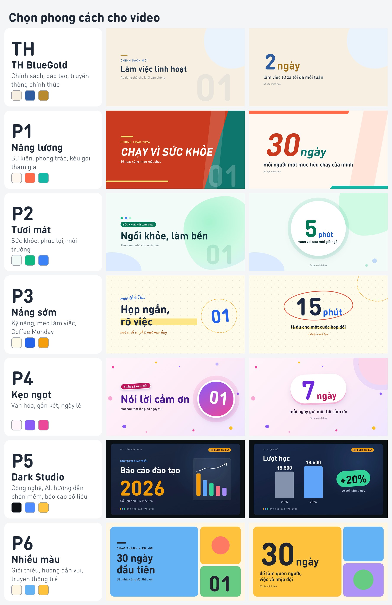
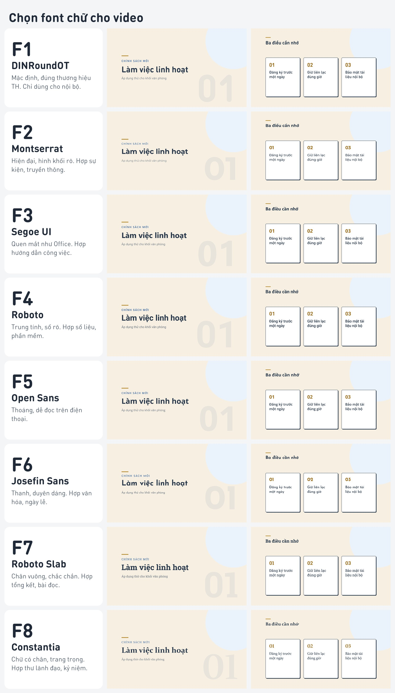

# ED_Video Studio

Bộ 5 skill cho Claude Code để làm video motion graphic trên [HyperFrames](https://github.com/heygen-com/hyperframes), từ tài liệu nội dung đến file MP4, giữ phong cách và giọng đọc đồng nhất theo series. Lời thoại, giao tiếp và tài liệu bằng tiếng Việt.

**Trang hướng dẫn (xem ngay trên trình duyệt):** https://thedoanh-gif.github.io/ed-video-skills/

## 5 skill

| Skill | Việc làm | Ai dùng |
|---|---|---|
| `ed-video-studio` | Điều phối từ input đến MP4, 3 điểm duyệt | Người làm video |
| `ed-video-script` | Viết kịch bản (lời đọc + ý hình) | Gọi trong quy trình, dùng riêng cũng được |
| `ed-video-illustrate` | Thiết kế cảnh minh họa và chuyển động cho từng ý | Khi cần hình minh họa kỹ |
| `ed-video-review` | Review độc lập, xuất danh sách cần sửa | Gọi trong quy trình, dùng riêng cũng được |
| `ed-video-style-library` | Phân tích video mẫu, lập Style Bible và Series Kit | Người quản kit |

## Phong cách và font

7 phong cách (TH BlueGold, P1 đến P6) và 8 font (F1 đến F8). Khi bắt đầu một video, skill gửi ảnh để bạn chọn.





## Cài đặt

Tải repo ([bản ZIP](https://github.com/thedoanh-gif/ed-video-skills/archive/refs/heads/main.zip), không cần tài khoản GitHub), giải nén, rồi chạy trong PowerShell tại thư mục repo:

```powershell
New-Item -ItemType Directory -Force "$env:USERPROFILE\.claude\skills" | Out-Null; Copy-Item -Recurse -Force .\skills\ed-video-* "$env:USERPROFILE\.claude\skills\"
```

Phần còn lại (Python, Node, FFmpeg, HyperFrames, font) xem [CAI-DAT.md](skills/ed-video-studio/CAI-DAT.md). Không bước nào cần quyền admin.

## Cập nhật

Đã cài rồi thì mở [mục Cập nhật](https://thedoanh-gif.github.io/ed-video-skills/#cap-nhat), chép câu lệnh U1 và dán vào Claude Code. Tự chạy tay: tải bản ZIP mới, rồi chạy `py -3 cap-nhat.py --xem` (xem trước) và `py -3 cap-nhat.py` (sao lưu và cập nhật) trong thư mục đã giải nén. Thay đổi từng bản: [CHANGELOG.md](skills/ed-video-studio/CHANGELOG.md).

## Dùng thử

Nhắn trong Claude Code:

```text
/ed-video-studio
Làm cho mình 1 video 5 phút về [chủ đề], cho [người xem], phát trên [kênh].
Tài liệu nội dung mình đính kèm.
```

Claude hỏi phong cách, font, giọng, nhạc, rồi dừng ở 3 điểm để bạn duyệt: kịch bản, đoạn pilot và bản cuối.

## Không có trong repo

- **Font DINRoundOT (F1).** Font thương hiệu, mỗi máy tự chép từ nguồn được phép dùng (xem CAI-DAT.md, mục 5). Không có thì chọn F2 đến F8.
- **Logo.** Người dùng tự đưa logo cho từng series.
- **Video mẫu.** Đặt trong thư mục làm việc `TH-Video/01_library/` trên máy.

## Giới hạn

- Không tạo được cảnh người thật. Người thật phải có file quay.
- P1, P2, P3, P4, P6 chưa được dùng cho video dài nào, và mới kiểm khổ 16:9.
- Giọng AI tiếng Việt dùng `edge-tts`, cần internet và là cách dùng không chính thức dịch vụ đọc của Microsoft Edge. Hợp cho bản nháp và video nội bộ.
- Các lệnh cài đặt chưa được chạy thử trên máy mới tinh.
- Mỗi video được tính vào hạn mức gói Claude.

Repo chưa gắn giấy phép sử dụng. Tên và nhận diện TH thuộc chủ sở hữu tương ứng. Thành phần của bên thứ ba: xem [THIRD_PARTY.md](THIRD_PARTY.md).
